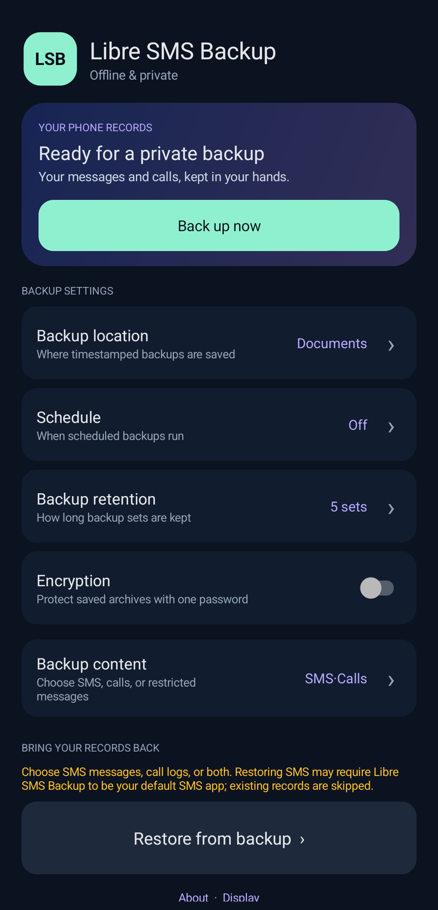
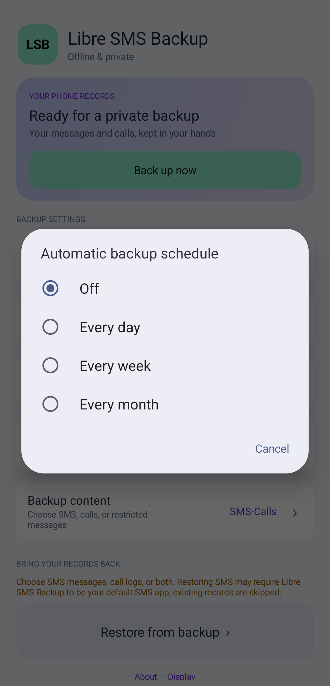
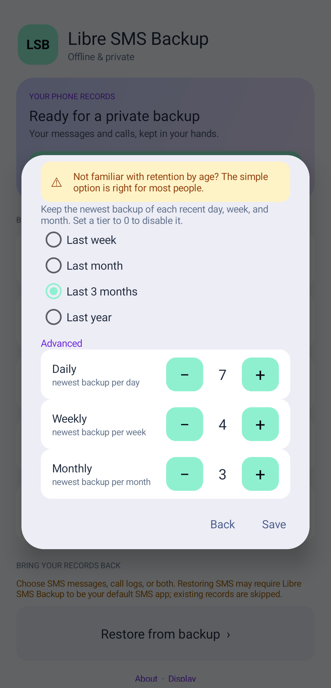

  

<h1 align="center">Libre SMS Backup</h1>

  <strong>Back up your messages and call history without giving the app internet access.</strong>
   
  No account · No ads · No analytics or tracking

  <a href="https://github.com/AshkanRafiee/Libre-SMS-Backup/releases">Download APK</a> ·
  <a href="https://cafebazaar.ir/app/com.ashkanrafiee.libresmsbackup">Cafe Bazaar</a>

Keep a copy of your SMS, available MMS, and call history in a folder you choose. Back up now or set a schedule for the records you want to keep.

## Private by design

Libre SMS Backup has **no Android internet permission** and does not ask for Contacts access. Back up and restore offline with local storage. If you choose a cloud-backed folder, its provider may sync the files; Libre SMS Backup does not upload them.

**Encryption is optional.** Enable it to protect new archives with AES-256-GCM. Without encryption, anyone with access to the file can read it. Keep the original password: you’ll need it to restore an encrypted archive.

## What you control

| Feature | What you can do |
| --- | --- |
| **Scheduled backups** | Choose a time for daily, weekly, or monthly backups. Keep messages, call logs, or both. |
| **Automatic retention** | Keep the newest sets, keep everything, or keep the newest available backup for each day, week, and month within windows you choose. The app trims older sets after a successful backup. |
| **Restore without starting over** | Restore just messages, just calls, or both. The app checks encrypted archives before writing any records and skips detected duplicates. |

## A look inside

  
  
  

## Before you start

Requires **Android 8.0+**. SMS/MMS restore may need the default SMS role temporarily; incoming MMS isn't handled while Libre SMS Backup holds it. Restricted-message backups pause scheduling, and RCS coverage depends on your device. See the [user guide](docs/USER-GUIDE.md) before switching phones or resetting one.

[Privacy policy](PRIVACY.md) · [GPL‑3.0 license](LICENSE) · [Report an issue](https://github.com/AshkanRafiee/Libre-SMS-Backup/issues)
